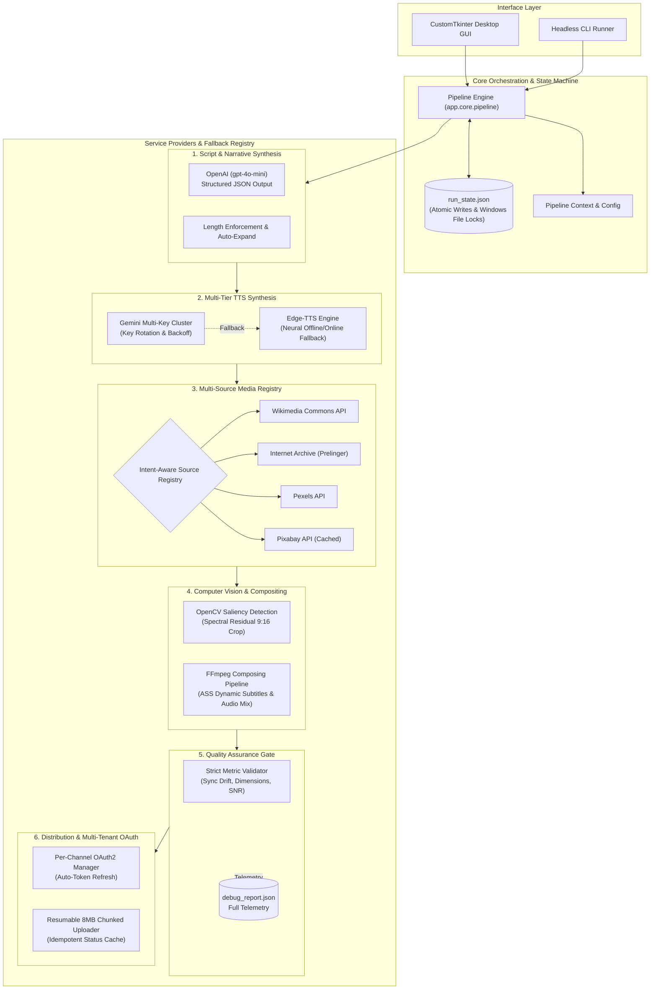

# Autonomous Multi-Channel Video Production Pipeline

[](https://www.python.org/)
[]()
[](https://ffmpeg.org/)
[](https://opencv.org/)
[](LICENSE)

An enterprise-grade, deterministic, and idempotent automated video generation and publishing pipeline. Built with Python, FFmpeg, and Clean Architecture principles, this engine synthesizes long-form and short-form (9:16 vertical / 16:9 widescreen) content with multi-source stock retrieval, saliency-aware framing, voice synthesis fallback mechanisms, and automated multi-channel YouTube distribution.

---

## 🎬 Demo & Visual Walkthrough

https://github.com/user-attachments/assets/a8adaaef-112f-429d-a13a-6728bc02965b

---

## 🔒 Project Status & Showcase Notice

This repository serves as a **public showcase and architectural portfolio** for an enterprise video production engine originally developed as a private production system.

- **Source Code Privacy:** Core execution engines, proprietary business rules, and generative pipeline scripts are maintained in a private repository.
- **Security & Secrets:** All live production tokens, OAuth client credentials, and cloud API keys are strictly excluded from public distribution.
- **Inquiries & Collaboration:** For architectural inquiries, live demos, or technical collaborations, please reach out via GitHub profile channels.

---

## 📐 System Architecture

The pipeline follows a modular **Clean Architecture** and **Pipes-and-Filters** pattern. Each domain (LLM script generation, multi-provider TTS, source-registry stock selection, computer vision saliency rendering, validation, and multi-tenant OAuth publishing) is isolated behind strict interfaces and orchestrated through an idempotent state machine.



---

## 🌟 Key Architectural Capabilities

### 1. Multi-Tier High Availability & Fallback Chains
- **Script Generation**: Enforces schema validation through OpenAI Structured Outputs. If target word/character budgets fail thresholds, automatic single-turn expand loops recover narrative continuity before downstream failures.
- **Voice Synthesis (TTS)**: Multi-key pooling across Gemini TTS endpoints with round-robin rotation, exponential backoff on `HTTP 429`, and automatic failover to `Edge-TTS` neural voice clusters (`tr-TR-AhmetNeural`, `en-US-GuyNeural`).
- **Media Ingestion**: Priority-weighted `Source Registry` queries across **Wikimedia Commons**, **Internet Archive / Prelinger Archives**, **Pexels**, and **Pixabay**. Media scoring ranks vertical aspect ratio (+25), high-definition bitrate (+20), duration matching (+15), and semantic tag alignment.

### 2. Idempotency & Resilient Crash Recovery
- **Deterministic Checkpointing**: Every execution step updates an atomic state descriptor (`run_state.json`). Steps are guarded by both state records and disk artifact checks.
- **Safe Re-entrancy**: If the process terminates abruptly (SIGINT, crash, power loss), the engine resumes directly from the failed stage without redundant third-party API calls or re-rendering completed assets.
- **Publishing Idempotency**: `upload_status.json` locks state to prevent duplicate uploads to YouTube channels across repeated invocations.

### 3. Saliency-Aware Dynamic Reframing
- Uses OpenCV's `StaticSaliencySpectralResidual` to analyze the visual center of attention on 16:9 stock assets, computing optimal bounding boxes for 9:16 vertical cropping without losing core focal subjects.
- Automated fallback chain: `Saliency Crop` $\to$ `Rule-of-Thirds Center Crop` $\to$ `Letterbox with Gaussian Blur`.

### 4. Mathematical Subtitle Synchronization
- Dynamic generation of Advanced SubStation Alpha (`.ass`) and SubRip (`.srt`) timing grids calculated strictly against the real audio waveform duration rather than arbitrary frame heuristics.
- Validates subtitle drift within strict timing tolerances ($\le 0.35\text{s}$) and text coverage ratios ($\ge 95\%$) to eliminate desync across varied render speeds.

---

## 🗂️ System Directory Structure

```
production_pipeline/
├── app/
│   ├── core/                  # Orchestration, run state manager, context & error classes
│   │   ├── pipeline.py        # Central 10-stage execution pipeline
│   │   ├── run_state.py       # Atomic state persistence and recovery
│   │   └── errors.py          # Unified domain exception hierarchy
│   ├── services/
│   │   ├── llm/               # OpenAI client, prompt engines, schema enforcement
│   │   ├── tts/               # Multi-key Gemini pooling & Edge-TTS fallback
│   │   ├── stock/             # Source Registry (Wikimedia, Archive, Pexels, Pixabay)
│   │   ├── render/            # FFmpeg runners, saliency crop, ASS subtitle engine
│   │   └── youtube/           # Multi-channel OAuth2 manager & resumable uploader
│   ├── ui/                    # CustomTkinter reactive GUI, dialogs, and real-time logs
│   └── utils/                 # Secret masking logger, backoff retry, HTTP pool
├── config/
│   ├── settings.py            # Environment validation & global system parameters
│   └── channel_profiles.py    # Content-to-channel immutable routing tables
├── assets/                    # Royalty-free audio tracks & font files
├── output/
│   ├── runs/                  # Intermediate stage artifacts (audio, raw clips, subtitles)
│   └── final/                 # Release packages (<channel>/<profile>/<timestamp>_<slug>/)
└── tests/                     # Unit, regression, and QA acceptance suites
```

---

## 🛡️ Error Tolerance & Self-Healing Matrix

| Failure Mode | Detection Point | Automated Self-Healing Mechanism |
| :--- | :--- | :--- |
| **LLM Output Truncation** | Stage 1 (Scripting) | Triggers single-pass contextual expansion to satisfy word count thresholds before failing. |
| **TTS Rate Limit (429)** | Stage 2 (Audio) | Automatically cycles across pooled Gemini keys; if exhausted, gracefully falls back to Edge-TTS. |
| **Stock Source Drought** | Stage 4 (Media Ingestion) | Traverses Source Registry fallback chain (Wikimedia $\to$ IA $\to$ Pexels $\to$ Pixabay) with fallback keyword adaptation. |
| **Aspect Ratio Mismatch** | Stage 5 (Trim/Crop) | Runs saliency detection for focal tracking; falls back to center crop or blurred backdrop letterboxing. |
| **Audio-Visual Drift** | Stage 8 (Validation) | Checks audio waveform length against video stream; warns or recalculates sync delta ($\le 0.35\text{s}$). |
| **OAuth Token Expiry** | Stage 10 (Upload) | Automatically invokes headless token refresh using stored refresh tokens; isolates secrets per channel. |
| **Network Drop During Upload** | Stage 10 (Upload) | Employs resumable 8 MB chunked uploads with status tracking in `upload_status.json`. |

---

## 🔌 API & Integration Specifications

### External Service Providers

| Integration | Protocol / Auth | Purpose | Resilience Strategy |
| :--- | :--- | :--- | :--- |
| **OpenAI API** | REST / Bearer Token | Narrative script & scene breakdown | Strict JSON schema + automated expand fallback |
| **Google Gemini API** | REST / API Key | High-fidelity voiceover synthesis | 3-key pool rotation with exponential backoff |
| **Microsoft Edge-TTS** | WebSocket / Neural Voice | Primary TTS fallback engine | Zero-cost backup tier across multiple language voices |
| **Wikimedia Commons** | MediaWiki API / REST | Location-specific historical stock | Semantic geo-querying with CC attribution parser |
| **Internet Archive** | Metadata API / S3 API | Mood & vintage historical footage | Prelinger archive indexer with fallback filters |
| **Pexels & Pixabay** | REST / API Key | Modern commercial stock footage | Local query cache, rate-limit backoff, duplicate exclusion |
| **YouTube Data API v3** | OAuth 2.0 (User Creds) | Channel-specific automated upload | Resumable chunked upload protocol, strict channel routing |

---

## 🛠️ Architecture & Engineering Highlights

- **Modular Design:** Strictly isolated domains aligned with Clean Architecture principles (LLM, TTS, Saliency CV, OAuth Publishing).
- **Resilience Engineering:** Multi-tier provider fallbacks across all critical external dependencies.
- **Zero-Trust Credential Isolation:** Strict token quarantining with regex-based runtime log scrubbing.
- **Automated Validation:** FFprobe stream verification and QA sanity checks ensuring AV synchronization.

---

## 🔒 Security & Privacy Notice

- **Zero-Secret Logging**: All outgoing standard outputs and log files pass through an automated regex-based redaction engine (`utils/logger.py`) that scrubs API keys, bearer tokens, and OAuth credentials.
- **Isolated Token Vault**: Channel secrets (`secrets/*.client_secret.json`) and access tokens (`tokens/*.token.json`) are quarantined outside application source code and excluded by default via `.gitignore`.
- **License Attribution**: Every downloaded media asset records license metadata and credit strings directly into `metadata.txt` for compliance with CC/PD licensing requirements.
