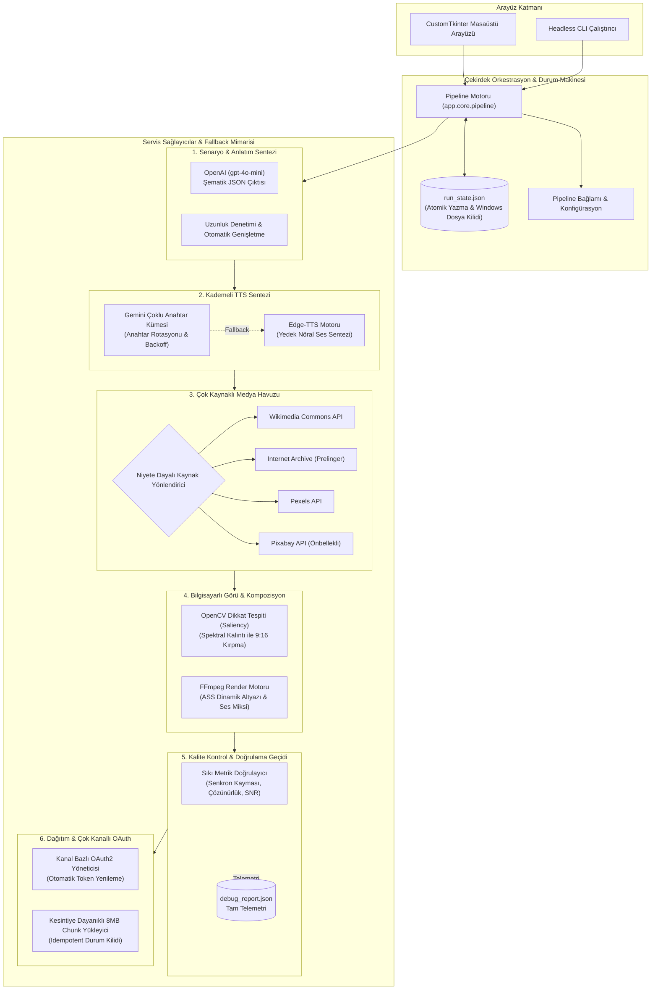

# Otonom Çok Kanallı Video Üretim Pipeline'ı

[](https://www.python.org/)
[]()
[](https://ffmpeg.org/)
[](https://opencv.org/)
[](LICENSE)

Kurumsal düzeyde, deterministik ve idempotent çalışan otonom video üretim ve dağıtım altyapısı. Python, FFmpeg ve Clean Architecture prensipleriyle geliştirilen bu motor; çok kaynaklı stok medya toplama, dikkat-odaklı (saliency-aware) kadrajlama, yedekli ses sentezi (TTS fallback) ve otomatik çok kanallı YouTube yayın süreçlerini uçtan uca yönetir.

---

## 🎬 Demo ve Görsel Önizleme

https://github.com/user-attachments/assets/a8adaaef-112f-429d-a13a-6728bc02965b

---

## 🔒 Proje Durumu ve Gizlilik Bildirimi

Bu depo, özel (**private**) olarak geliştirilen ana üretim sisteminin mimari tasarımını, teknik kabiliyetlerini ve yeteneklerini sergilemek amacıyla hazırlanmış bir **Public Showcase / Portfolio** sürümüdür.

- **Kaynak Kod Gizliliği:** Çekirdek üretim motoru, ticari algoritmalar ve hassas operasyonel iş kuralları gizli (özel) repoda muhafaza edilmektedir.
- **Güvenlik & Sırlar:** Canlı kanallara ait kimlik bilgileri, OAuth token'ları ve API anahtarları açık kaynak kod tabanında yer almaz.
- **İletişim & İş Birliği:** Sistemin canlı demonstrasyonu, mimari detayları veya iş birliği talepleri için repo sahibi ile iletişime geçebilirsiniz.

---

## 📐 Sistem Mimarisi ve **Pipes-and-Filters** tasarım desenlerini benimser. Her operasyonel katman (LLM senaryo üretimi, çok sağlayıcılı TTS, kaynak-havuzlu stok seçimi, bilgisayarlı görü ile kadrajlama, kalite kontrol ve çok kanallı OAuth yayınlama) bağımsız arayüzler arkasında izole edilmiş ve idempotent bir durum makinesiyle koordine edilmiştir.



---

## 🌟 Öne Çıkan Mimari Yetkinlikler

### 1. Çok Katmanlı Yüksek Erişilebilirlik ve Fallback Zincirleri
- **Senaryo Üretimi**: OpenAI Structured Outputs ile katı şema doğrulaması uygulanır. Hedef karakter veya kelime sınırları altında kalınırsa, akış bozulmadan tek turlu otomatik genişletme (expand loop) tetiklenir.
- **Ses Sentezi (TTS)**: Çoklu API anahtarı havuzlama ile `HTTP 429` hatalarında dinamik rotasyon ve üstel geri çekilme (exponential backoff) uygulanır. Tüm anahtarlar tükenirse sistem kesintisiz olarak `Edge-TTS` nöral ses altyapısına (`tr-TR-AhmetNeural`, `en-US-GuyNeural`) geçer.
- **Medya Temini**: **Wikimedia Commons**, **Internet Archive / Prelinger**, **Pexels** ve **Pixabay** üzerinde çalışan öncelik tabanlı `Source Registry`. Algoritmik skorlama; dikey format (+25), yüksek çözünürlük (+20), sahne süresi uyumu (+15) ve semantik etiket benzerliğini puanlar.

### 2. Idempotent Yapı ve Çökme Sonrası Devam Edebilirlik (Crash Recovery)
- **Deterministik Durum Kaydı**: Her adım çıktısı `run_state.json` içine atomik olarak yazılır. Adımlar hem durum tablosu hem de dosya varlığıyla korunur.
- **Güvenli Yeniden Başlatma**: İşlem beklenmedik şekilde kesilirse (SIGINT, çökme, elektrik kesintisi), motor gereksiz API harcaması veya mükerrer render yapmadan doğrudan kaldığı adımdan devam eder.
- **Yayın İdempotansı**: `upload_status.json` kaydı sayesinde aynı export paketinin YouTube'a mükerrer yüklenmesi mimari düzeyde engellenir.

### 3. Bilgisayarlı Görü ile Dikkat-Odaklı Kadrajlama (Saliency Crop)
- Yatay (16:9) stok videoları 9:16 dikey formata dönüştürürken OpenCV'nin `StaticSaliencySpectralResidual` algoritması kullanılır. Ana görsel odak noktasının koordinatları saptanarak kadraj merkezinin kaydırılması sağlanır.
- Kademeli fallback akışı: `Saliency Crop` $\to$ `1/3 Kuralı Merkez Kırpma` $\to$ `Bulanık Arka Planlı Letterbox`.

### 4. Matematiksel Altyazı Senkronizasyonu
- Gelişmiş ASS (`.ass`) ve SRT (`.srt`) altyazı zamanlamaları, rasgele kare tahminleri yerine gerçek ses dalgası (`voice.mp3`) süresine göre hesaplanır.
- Ses ve altyazı bitiş toleransı ($\le 0.35\text{s}$) ve metin kapsama oranı ($\ge \%95$) sıkı denetimlerden geçerek senkron kaymaları engellenir.

---

## 🗂️ Dizin Ağacı

```
production_pipeline/
├── app/
│   ├── core/                  # Orkestrasyon, run_state yöneticisi, context & hata sınıfları
│   │   ├── pipeline.py        # 10 adımlı merkezi yürütme motoru
│   │   ├── run_state.py       # Atomik durum kaydı ve geri yükleme
│   │   └── errors.py          # Birleşik domain istisna hiyerarşisi
│   ├── services/
│   │   ├── llm/               # OpenAI istemcisi, prompt motoru, şema denetimi
│   │   ├── tts/               # Çoklu Gemini anahtar rotasyonu & Edge-TTS fallback
│   │   ├── stock/             # Kaynak Havuzu (Wikimedia, Archive, Pexels, Pixabay)
│   │   ├── render/            # FFmpeg çalıştırıcıları, saliency crop, ASS altyazı motoru
│   │   └── youtube/           # Çok kanallı OAuth2 yöneticisi & chunked yükleyici
│   ├── ui/                    # CustomTkinter reaktif arayüz, iletişim kutuları ve canlı loglar
│   └── utils/                 # Maskeli loglama, backoff mekanizması, HTTP havuzu
├── config/
│   ├── settings.py            # Ortam değişkenleri doğrulaması & global ayarlar
│   └── channel_profiles.py    # İçerik profili ↔ Kanal eşleştirme tabloları
├── assets/                    # Telifsiz müzik parçaları & yazı tipleri
├── output/
│   ├── runs/                  # Ara aşama artifaktları (ses, ham klipler, altyazılar)
│   └── final/                 # Dağıtım paketleri (<kanal>/<profil>/<zaman>_<slug>/)
└── tests/                     # Birim, regresyon ve QA doğrulama paketleri
```

---

## 🛡️ Hata Toleransı & Öz-İyileştirme Matrisi

| Hata Senaryosu | Tespit Noktası | Otomatik Çözüm Mekanizması |
| :--- | :--- | :--- |
| **LLM Metin Kesintisi** | 1. Adım (Senaryo) | Kelime/karakter alt limitine ulaşılamazsa tek seferlik bağlamsal genişletme (expand) tetiklenir. |
| **TTS Kota Aşımı (429)** | 2. Adım (Ses) | Havuzdaki diğer Gemini anahtarlarına geçer; tamamı tükenirse kesintisiz Edge-TTS devreye girer. |
| **Stok Kaynak Yetersizliği** | 4. Adım (Stok Medya) | Kaynak zinciri boyunca arama derinleştirilir (Wikimedia $\to$ IA $\to$ Pexels $\to$ Pixabay). |
| **En-Boy Oranı Uyumsuzluğu** | 5. Adım (Kırpma) | Saliency ile odak nesne izlenir; tespit edilemezse dinamik merkez crop veya bulanık kenarlık uygulanır. |
| **Ses-Görüntü Senkron Kayması** | 8. Adım (Doğrulama) | Dalga formu süresi video akışıyla kıyaslanır; senkron delta ($\le 0.35\text{s}$) tolerans dışındaysa adım yenilenir. |
| **OAuth Token Süre Aşımı** | 10. Adım (Yükleme) | Arka planda refresh token ile yeni erişim anahtarı alınır; kanal sırları izole tutulur. |
| **Yükleme Sırasında Bağlantı Kopması** | 10. Adım (Yükleme) | 8 MB'lık parçalar halinde kaldığı yerden devam edebilen (resumable) transfer yürütülür. |

---

## 🔌 API & Entegrasyon Tablosu

| Entegrasyon | Protokol / Yetki | Rolü | Dayanıklılık Stratejisi |
| :--- | :--- | :--- | :--- |
| **OpenAI API** | REST / Bearer Token | Senaryo kurgusu ve sahne ayrımı | Katı JSON şeması + otomatik genişletme fallback'i |
| **Google Gemini API** | REST / API Key | Yüksek kaliteli seslendirme | 3 anahtarlı rotasyon havuzu + üstel geri çekilme |
| **Microsoft Edge-TTS** | WebSocket / Neural | Birincil ses yedekleme motoru | Sıfır maliyetli çok dilli nöral ses kümesi |
| **Wikimedia Commons** | MediaWiki API / REST | Konum-odaklı tarihsel stoklar | CC lisans atıf ayrıştırıcısı ile semantik arama |
| **Internet Archive** | Metadata API / S3 | Atmosferik ve vintage arşiv görüntüleri | Prelinger arşivi indeksleyici ve filtreleme |
| **Pexels & Pixabay** | REST / API Key | Güncel ticari stok videolar | Yerel sorgu önbelleği, kota yönetimi, kopya eleme |
| **YouTube Data API v3** | OAuth 2.0 (Kullanıcı) | Kanala özgü otomatik yayın | Parçalı (resumable) protokol, izole kanal yönlendirmesi |

---

## 🛠️ Mimari & Mühendislik Yaklaşımı

- **Modüler Tasarım:** Clean Architecture prensipleriyle ayrıştırılmış katmanlar (LLM, TTS, CV, Upload).
- **Hata Toleransı (Resilience):** Her harici serviste yedekli (fallback) sağlayıcı mekanizması.
- **Güvenli Kimlik Yönetimi:** Çift katmanlı yetki izolasyonu ve regex tabanlı log temizleme filtresi.
- **Doğrulama ve QA:** FFprobe destekli ses/görüntü senkron denetimi ve otomatik doğrulama katmanı.

---

## 🔒 Güvenlik & Gizlilik İlkeleri

- **Sıfır-Sır Loglama**: Standart çıktılar ve log dosyaları `utils/logger.py` filtresinden geçirilerek tüm API anahtarları, token'lar ve yetki parametreleri regex ile temizlenir.
- **İzole Kimlik Deposu**: Kanallara ait yetki dosyaları (`secrets/*.client_secret.json`) ve token havuzu (`tokens/*.token.json`) kaynak kodun dışında tutulur ve `.gitignore` ile korunur.
- **Otomatik Telif ve Lisans Yönetimi**: İndirilen tüm stok materyallerin lisans ve atıf bilgileri derlenerek `metadata.txt` içine eklenir.

